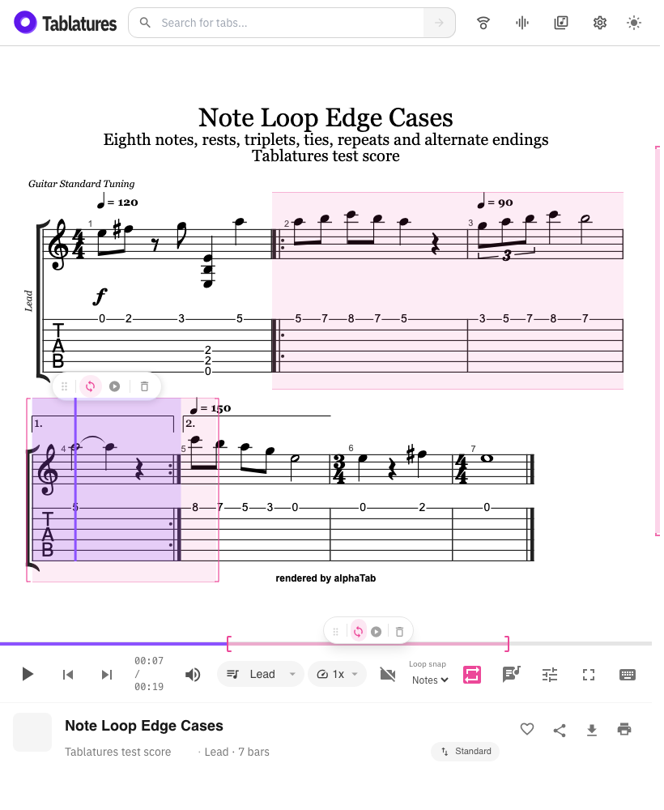

# Note-level practice loops

Feature branch: `codex/note-level-loops`.


Note snapping is the default. The optional **Bars** mode is available under
**Loop snapping** in player settings on desktop and phone. The play bar has no
snapping selector.

- Drag across notes on the score to include the first onset through the end of
  the last selected note or rest. Reverse selection works too. Where voices
  start together, a drag endpoint takes the longest event there, because the
  pointer cannot tell the voices apart.
- Double-click a note or rest to loop that position. Chords are one event.
  A normal click seeks and clears the previous loop.
- Score selections play the highlighted notes in **printed order**. Repeat signs,
  alternate-ending skips, and score jumps do not pull unselected passages into
  a practice loop. Selecting the first ending into the second plays those two
  selected passages directly, then returns to the start marker.
- Resize either edge on the score or timeline. Move the region with its grip
  or the timeline selection. Moves snap the start and retain the musical
  duration; the ending can fall inside a longer note at the new location.
- Choose Bars in settings to expand the selection to full printed bars.
- Disable or clear a score loop to restore the song's normal repeat order.
  Editing a disabled practice marker keeps it disabled until explicitly enabled.
- Hold on the timeline, then drag, to select note/rest positions. The timeline
  follows the active playback order: normal song repeat visits outside practice,
  printed order while a score practice loop is enabled.



## Edge-case score

Import `tests/fixtures/player/note-loop-edge-cases.gp`. Its editable source is
`note-loop-edge-cases.tex` beside it. Regenerate the GP file with
`node tests/fixtures/player/generate-note-loop-score.mjs`. The second track,
Rhythm, uses longer chords to exercise track changes with different note grids.

1. Bar 1: eighth notes, an eighth rest, a chord, and a quarter note.
2. Bar 2: opening of the repeated section; mixed notes and a quarter rest.
3. Bar 3: tempo 90, eighth-note triplets, and a sustained half note.
4. Bar 4: first ending; a half note tied into a quarter, then a rest.
5. Bar 5: second ending and tempo 150.
6. Bar 6: switch to 3/4, including a quarter rest.
7. Bar 7: return to 4/4 and a whole note at the end of the score.

Normal playback visits (one-based bars): **1, 2, 3, 4, 2, 3, 5, 6, 7**.
Practice visits: **1, 2, 3, 4, 5, 6, 7**, with native playback restricted to
selected notes. Selecting bar 4's first note through bar 5's first eighth note
creates `[11520, 15840)` on the practice clock, without repeating bars 2–3.

## Storage and playback

New score selections use `?loop=w.<startTick>.<endTick>[.off]`, whose ticks refer
to printed order. Existing `?loop=1.2[.off]` bar links and
`?loop=n.<startTick>.<endTick>[.off]` performance links retain their behavior.
Tick ranges are validated once score timing loads.

A persistent practice controller regenerates native MIDI once when entering or
leaving printed-order practice. Repeat and direction metadata are suppressed
only during synchronous generation and restored immediately, including on
errors. The notation and exported score keep their original repeat signs.
Native synthesizer looping handles every subsequent wrap and note transition;
there are no timer-driven audio seeks between selected bars. Editing loop bounds
does not regenerate MIDI. Playing transport resumes after an order change.

The score, timeline, native range, shared state, and saved link use the same
active clock. Practice continues in the mini player and through track changes.
The timeline's duration changes with the active playback order. Video positions
map back to the original performance clock, seeking across omitted repeat
passages and applying playback speed and media offset. Timed lyrics and the
video tap-to-sync controls also use the original recording clock.

Boundaries clip sustained notes at the end of the loop. Seeking into a tied
continuation relies on alphaTab's MIDI seek behavior; practice does not insert
note attacks. Before-beat grace notes belong to the note they ornament: a selection that
starts on a note includes its grace notes, choosing a grace note selects its note,
and a selection ending on a note stops where the next note's grace notes begin
(alphaTab cuts the note there). A grace note before the first beat sounds in a
lead-in before tick 0. alphaTab maps ticks back but not time, so the timing
model counts that lead-in from 0 ms and links may start at a negative tick
(`w.-120.960`). Notes past the end of an overfull bar keep their duration and
can be selected where they sound. Video transitions and very short loops remain subject to the
video provider's seek latency.

## GP edge-case suite

`tests/fixtures/player/loop-edge-cases/` holds 17 Guitar Pro files, one per
area of the format that loops depend on: pickups, repeat counts, nested
repeats, alternate endings (three endings, shared ending bars), D.S. al Coda,
D.C. al Fine, meters and free time, tempo changes inside bars and repeats,
tuplets and short values, ties into endings, grace notes, voices, grand staff
and percussion tracks, irregular bars, a one-note score, and a combined score.
`cases.json` records each file's coverage and its musically expected song
order. Regenerate with `node tests/fixtures/player/loop-edge-cases/generate.mjs`.
The generator fails when the GP round trip loses anything loops read.

- `src/library/utils/loopEdgeCases.test.ts` loads each GP file and checks that
  practice MIDI attacks every printed note exactly once in printed order. It also
  checks that every score selection and timeline drag (both clocks, 0.5–2×) is a
  valid, direction-independent loop, that disabled markers map to the same bars,
  and that a practice session enters and leaves printed order.
- `tests/loop-edge-cases.spec.ts` creates loops on every file through real
  score drags and timeline drags, in both playback orders.

Known issues are pinned in `cases.json` (`alphaTabVisits`, `knownIssues`). The
generator and tests check alphaTab's current behaviour, so a fix upstream (or a
change in it) fails the suite until the entry is updated. One issue remains.

## Known issue: endings that each close the repeat

alphaTab replays a repeat group once per closing barline when more than one
alternate ending closes the same repeat. This is the usual Guitar Pro layout for
three endings:

```
\ro :1 0.1 | :1 2.1 | \ae 1 \rc 3 :1 3.1 | \ae 2 \rc 3 :1 5.1 | \ae 3 :1 7.1 | :1 0.1
```

| | Bar order (zero-based) |
|---|---|
| Expected | 0 1 2 · 0 1 3 · 0 1 4 · 5 |
| alphaTab | 0 1 2 0 1 0 1 0 1 2 0 1 0 1 3 0 1 2 0 1 0 1 4 5 |

A bar shared by endings 1 and 3, with ending 2 closing separately, fails the same
way (file 17). A single closing barline (`\ae 1 \rc 2` then `\ae 2`) is correct.

- **Affected:** the song order outside practice, which drives the timeline,
  playback without a loop, and disabled practice markers.
- **Not affected:** score loops. Practice regenerates MIDI in printed order with
  repeat metadata suppressed, so they play the selected notes as intended.
- **Versions checked:** 1.8.1 (in use), 1.8.4 (latest stable) and
  1.9.0-alpha.1891 (latest prerelease) behave identically. No matching upstream
  issue was found.
- **Next steps:** report upstream with the repro above. If real tabs hit this
  often, the app could compute the song order itself, as practice already does
  for printed order.

## Verification

- `pnpm exec vitest run`
- `pnpm exec playwright test tests/note-loop.spec.ts tests/loop.spec.ts tests/loop-editing.spec.ts tests/loop-repeat.spec.ts tests/player-correctness.spec.ts tests/lyrics.spec.ts --workers=1`
- `pnpm check`
- `pnpm build:app`

Browser tests import the generated GP file through the catalog loading path and
exercise real score and timeline gestures, marker placement, native playback
visits and wraps, disabled markers, reloads, legacy links, track changes, phone
controls, and mini playback. Unit tests use native MIDI generation to verify
practice order, restoration of repeats and score jumps, tempo timing, disposal,
and video position mapping at 0.5×, 1×, 1.5×, and 2×.

Additional regressions cover pickup lengths, nested repeats, and simultaneous
voices. Equal-onset cross-voice selections keep the longer selected note in both
drag directions; timeline snapping prefers the shorter event at a shared onset.
Score resizing retains hit targets even when two voices have identical timings.
