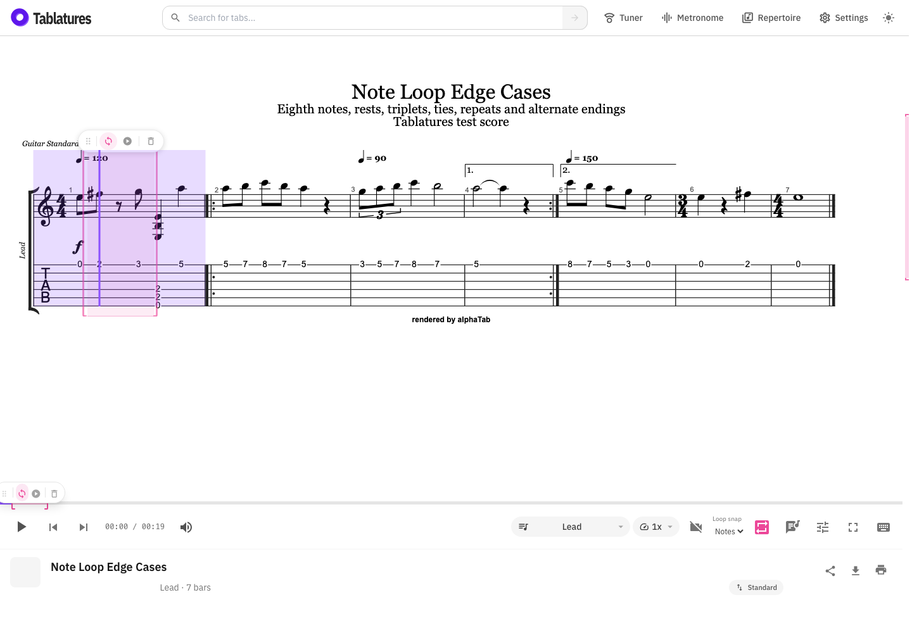

# Note-level loops

Feature branch: `codex/note-level-loops`.

Choose **Notes** under **Loop snap** beside the desktop repeat button, or under
**Loop snapping** in player settings on a phone. Bars remains the default.

- Drag across notes on the score to include the first onset through the end of
  the last selected note or rest. Reverse selection works too.
- Double-click a note or rest to select just that position. Chords are selected
  as one event. A normal click continues to seek and clear the previous loop.
- Hold on the timeline, then drag, to select individual note/rest positions.
  Holding and releasing without moving selects a single position.
- Resize either edge on the score or timeline. Move the region with its grip
  or the timeline selection. Moves snap the start and retain the musical
  duration, so the ending can fall inside a longer note at the new location.
- Switch back to Bars to expand the selected written bars to full bars.

## Edge-case score

Import `tests/fixtures/player/note-loop-edge-cases.gp` into the player. Its
editable source is `note-loop-edge-cases.tex` beside it. Regenerate the GP file
with `node tests/fixtures/player/generate-note-loop-score.mjs`. The second track,
Rhythm, uses longer chords to exercise track changes with different note grids.

1. Bar 1: eighth notes, an eighth rest, a chord, and a quarter note.
2. Bar 2: opening of the repeated section; mixed notes and a quarter rest.
3. Bar 3: a tempo change to 90, eighth-note triplets, and a sustained half note.
4. Bar 4: first ending; a half note tied into a quarter, then a rest.
5. Bar 5: second ending and a tempo change to 150.
6. Bar 6: a switch to 3/4, including a quarter rest.
7. Bar 7: return to 4/4 and a whole note at the end of the score.

Playback visits (one-based written bars): **1, 2, 3, 4, 2, 3, 5, 6, 7**.
The second visit to bar 2 starts at tick 15360; selecting its second eighth
note creates `[15840, 16320)`. A loop spanning the repeat jump can retain
`[14400, 16320)` even though playback moves from written bar 4 back to bar 2.

Score selections retain the existing smallest contiguous playback-span rule,
with the earliest visit winning ties. Timeline selections retain the exact
repeat pass being selected. The score cannot visually distinguish two visits
to the same written note; the timeline shows the selected pass.

## Storage and playback

Precise ranges use expanded MIDI ticks, shared by the synthesizer, timeline,
persistent player state, and video synchronization. Tick-to-time conversion
continues to use the tempo map and playback speed. No alphaTab changes are
required.

Existing `?loop=1.2[.off]` links keep their full-bar behavior. Precise links use
`?loop=n.15840.16320[.off]`; they are validated after MIDI timing loads.
Track changes leave the playback boundaries intact; subsequent edits snap to
positions on the active track.

Boundaries clip sustained notes at the end of the loop. Seeking into a tied
continuation relies on alphaTab's MIDI seek behavior; the feature does not
rewrite ties or insert note attacks. Video loops use the same boundaries, but
very short loops remain subject to the video provider's seek latency.

## Verification

- `pnpm exec vitest run src/library/utils/loopRegion.test.ts src/library/utils/playerTiming.test.ts src/library/utils/videoSession.test.ts`
- `pnpm exec playwright test tests/note-loop.spec.ts tests/loop.spec.ts tests/loop-editing.spec.ts tests/loop-repeat.spec.ts --workers=1`
- `pnpm check`

The note-loop browser tests import the generated GP file through the catalog
loading path and use real score/timeline gestures. The unit tests parse the
AlphaTex source and verify independent expected playback ticks.

Validation completed: all 314 unit tests passed; all 58 browser cases passed
(one fixture-download timeout in the combined run passed when rerun alone).
The application check reported zero errors and 16 existing warnings.

The production application build (`pnpm build:app`) succeeded.
